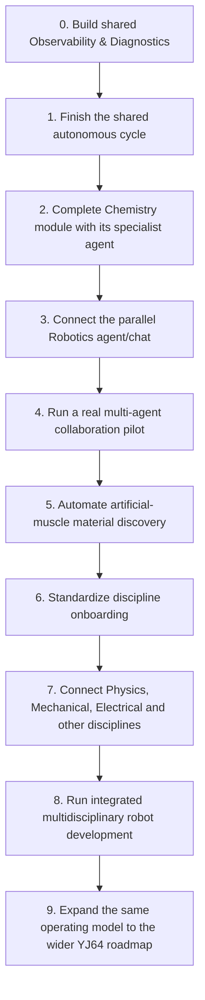

# YJ64 — Strategic Master Plan
Last reconciled: 2026-11-17
Repository: `concreteballs/YJ64-Engineering-Core`
Authorized branch: `main`

> This is the strategic graph for the whole programme. The numbered stages express the intended order. Each expandable section is the implementation checklist for that stage. Detailed engineering status remains in [IMPLEMENTATION_STATUS.md](IMPLEMENTATION_STATUS.md); autonomous-cycle technical tasks remain in [AUTONOMOUS_ENGINEERING_CYCLE_AND_MASTER_ROADMAP.md](AUTONOMOUS_ENGINEERING_CYCLE_AND_MASTER_ROADMAP.md).

## Strategic graph

Stage 0 is a cross-cutting foundation and runs in parallel with the autonomous cycle; every later stage inherits its instrumentation requirements. The graph is a dependency order, not a claim that every stage is already implemented. Work may overlap where prerequisites are satisfied, but later stages must not be called operational before their acceptance checks pass. See [YJ64_MONITOR_REUSE_AND_INTEGRATION_PLAN.md](YJ64_MONITOR_REUSE_AND_INTEGRATION_PLAN.md) for the assessed Android monitor prototype and migration path.

---

## 0. Build shared Observability & Diagnostics
**Goal:** every task, build, agent handoff and solver execution must leave enough correlated evidence to identify what failed and where, instead of debugging blindly.

Open implementation steps and acceptance criteria

### Implementation
1. Define and test a versioned structured event/error schema and mandatory secret-redaction rules. A tested first implementation now exists in `src/yj64_engineering_core/observability/events.py`; collection and integration remain outstanding.
2. Propagate trace, span, correlation, task, workflow, job, commit and deployment identifiers across every service boundary.
3. Standardize structured logs and safe error classification; preserve validated SQLSTATE, HTTP status, exit code and sanitized stack/log references.
4. Generate a bounded diagnostic bundle for failed/suspicious tasks: exact versions, failed step, logs, retry history, queue state, artifact hashes and environment fingerprint.
5. Add metrics for success/failure, latency, queue age/depth, retries, leases, worker health, solver duration, resource use and cost.
6. Add end-to-end distributed traces across CI → webhook → database/queue → dispatcher → worker → agent/module → solver → artifact → validation.
7. Add authenticated ingestion, durable telemetry storage, bounded offline spool/forwarding and explicit delivery acknowledgements. Reuse the existing [YJ64 monitor prototype](https://github.com/concreteballs/yj64-clean-bial2modFun5) as a source for protocol and delivery patterns, not as an Android dependency of the core.
8. Add dependency-aware readiness checks, alerts and an operator drill-down view.
9. Add evidence-based diagnostic triage that ranks hypotheses, asks for the cheapest missing evidence and proposes minimal fixes with regression tests.
10. Add fault-injection tests for database/schema/auth failures, duplicate events, expired leases, worker crashes, solver timeouts, invalid artifacts and telemetry outages.
11. Enforce telemetry retention, access controls, sampling, cardinality limits, redaction and storage/token/cost budgets.

### Mandatory module integration gate
No new or existing engineering module is considered **fully integrated** until it emits events conforming to the common schema, propagates stable module/task/correlation identity, records start/completion/failure/degraded states, attaches relevant artifact hashes and provenance, redacts sensitive data, and delivers events to shared collection or a bounded recoverable spool with visible delivery state. Local-only logs count as prototype diagnostics, not full platform integration.

### Acceptance
- One task/run ID reveals the complete execution path and exact failed stage.
- Failures have stable categories and useful diagnostic evidence, or an explicit evidence-gap report.
- Logs, metrics and traces correlate across components.
- Automated tests prove secrets are redacted.
- Stuck work and repeated failures trigger actionable alerts.
- A fault-injection exercise localizes a failure and validates the smallest justified fix without blind retries.

**Existing foundation:** the webhook API has limited safe SQLSTATE classification; the shared event envelope and initial redaction tests are implemented. The Android monitor prototype supplies a reusable offline-spool and durable-acknowledgement pattern but is not yet integrated. See [OBSERVABILITY_AND_DIAGNOSTICS_ARCHITECTURE.md](OBSERVABILITY_AND_DIAGNOSTICS_ARCHITECTURE.md) and [YJ64_MONITOR_REUSE_AND_INTEGRATION_PLAN.md](YJ64_MONITOR_REUSE_AND_INTEGRATION_PLAN.md).

---

## 1. Finish the shared Autonomous Engineering Cycle
**Goal:** one cloud-based operating cycle that can continue work when the user's phone is offline.

Open implementation steps and acceptance criteria

### Implementation
1. Finish reliable GitHub Actions completion-event delivery to the authenticated receiver.
2. Verify actual PostgreSQL persistence in Supabase: event record, durable task, deduplication and queue state.
3. Verify atomic task claims, leases, bounded retries, completion/blocked states and recovery after worker restart.
4. Deploy a separate cloud worker that can claim tasks without relying on the phone, browser, or an open ChatGPT conversation. The worker must comply with the [Session Independence Protocol](SESSION_INDEPENDENCE_PROTOCOL.md): durable task state is authoritative; model calls are replaceable, bounded sessions; context rollover is automatic and recoverable.
5. Connect a server-side model provider using a separately configured API key; do not assume a ChatGPT subscription is an API credential.
6. Implement [MODEL_PROVIDER_LIMITS_AND_CHUNKED_INGESTION.md](MODEL_PROVIDER_LIMITS_AND_CHUNKED_INGESTION.md): detect provider RPM/TPM/context/concurrency/quota limits and structured errors; schedule Retry-After/reset-aware retries; adaptively chunk oversized inputs; verify ordered chunk hashes and explicit FINALIZE before model work. Stateless calls must be assembled by the orchestrator, not assumed to accumulate.
7. Make the worker read this strategic plan, the detailed roadmap and implementation ledger; select only the next unblocked task.
8. Require exact-commit CI validation before a task is marked complete or the next dependent task is started.
9. Add bounded repair attempts, task/time/token/cost budgets, pause/resume/cancel, kill switch and safe blocked states.
10. Add external notifications and a status view for active task, queue, last commit, CI result, next task, budget and stop reason.
6. Make the worker read this strategic plan, the detailed roadmap and implementation ledger; select only the next unblocked task.
7. Require exact-commit CI validation before a task is marked complete or the next dependent task is started.
8. Add bounded repair attempts, task/time/token/cost budgets, pause/resume/cancel, kill switch and safe blocked states.
9. Add external notifications and a status view for active task, queue, last commit, CI result, next task, budget and stop reason.

### Acceptance
- A task is durably queued.
- The cloud worker claims it while the phone is offline.
- It makes a small authorized change in this repository and on `main`.
- CI runs for the exact resulting commit.
- Completion event is authenticated, persisted and deduplicated.
- The worker records the evidence and advances, or stops with a clear reason.
- Restart does not lose or duplicate work.
- Context-window exhaustion triggers a persisted checkpoint and a fresh model request automatically, without a user pressing “New chat”.
- A new worker process can resume from durable state without access to the previous model conversation.
- Replayed or uncertain in-flight operations are handled idempotently and do not duplicate external side effects.
- Pause/kill switch and budget limits are demonstrated.

**Exit gate:** do not call the cycle autonomous until the full acceptance sequence passes. Do not start broad automated module development before this gate.

## 2. Complete Chemistry & Molecular Design with its specialist agent
**Goal:** make the chemistry discipline a usable, tested engineering module before using it for sustained autonomous discovery.

Open implementation steps and acceptance criteria

### Implementation
1. Review the current Chemistry & Molecular Design contracts, tests and documented limitations with the chemistry specialist agent.
2. Identify the missing capabilities needed for responsive materials: molecular/structure intake, composition and formulation representation, processing conditions, material-property evidence and candidate comparison.
3. Keep chemistry and Artificial Muscle Engineering connected through versioned shared material request/candidate contracts.
4. Define machine-readable task inputs and outputs so the shared dispatcher can schedule chemistry work and store results.
5. Separate hypotheses, heuristic screening, deterministic calculations, external solver outputs and experimental evidence.
6. Add reproducible fixtures, benchmarks and tests for candidate generation/screening and exchange with the actuator module.
7. Record exact dependencies, versions, licences, runtime requirements and compute budgets for every proposed scientific tool.
8. Do not claim quantum chemistry, molecular dynamics, synthesis prediction or material performance prediction until the corresponding toolchain is actually integrated and validated.

### Acceptance
- The chemistry agent can receive a typed task and return a versioned, traceable result.
- The result can be consumed by Artificial Muscle Engineering without manual reformatting.
- Tests cover contracts, invalid inputs, provenance and evidence level.
- Missing solvers/data are reported as explicit limitations, not silently replaced by LLM guesses.

## 3. Connect the parallel Robotics agent/chat
**Goal:** let the agent responsible for the humanoid robot work with the same project state and shared engineering services.

Open implementation steps and acceptance criteria

### Implementation
1. Define an authenticated agent/API bridge for task submission, status retrieval and result delivery.
2. Connect the robotics agent to the common project memory: requirements, component revisions, material requests, calculations, decisions and artifacts.
3. Give the agent scoped permissions for its discipline and the authorized repository; do not grant unrelated repository access.
4. Define context handoff: task ID, objective, constraints, input versions, expected output schema and evidence requirements.
5. Make results return as structured artifacts/events, not only free-form chat messages.
6. Preserve human approval for consequential changes and operations.

### Acceptance
- The robotics agent can submit a task and retrieve its status.
- It can consume a chemistry result and return a typed engineering response.
- Task identity, provenance and version dependencies survive the handoff.
- A disconnected chat does not cause task state to disappear.

**Important:** connecting a chat is a separate integration. The shared worker cannot automatically wake or resume an arbitrary ChatGPT conversation unless a supported bridge explicitly provides that capability.

## 4. Run a real multi-agent collaboration pilot
**Goal:** test whether the process works in practice before scaling it.

Open implementation steps and acceptance criteria

### Pilot sequence
1. Robotics agent creates a material requirement for a specified artificial-muscle use case.
2. Dispatcher routes the request to Chemistry & Molecular Design.
3. Chemistry agent creates or screens candidates and records assumptions, evidence and uncertainty.
4. Artificial Muscle Engineering evaluates the candidates against actuator requirements.
5. Physics/engineering checks reject impossible or inconsistent proposals where the required models exist.
6. Results and unresolved questions return to the robotics agent.
7. The agents revise the task using explicit versioned feedback rather than overwriting earlier results.

### Measure
- Correctness and completeness of task handoffs.
- Whether agents use the same current requirements and component versions.
- Lost, duplicated or contradictory tasks.
- Reproducibility of results and ability to trace decisions.
- Time, compute and API cost per completed iteration.
- Whether failures stop safely and are understandable.

### Acceptance
Complete at least one end-to-end task with a traceable request, candidate, evaluation, returned result and independently passing software tests. This pilot validates the collaboration process, not the physical performance of a muscle material.

## 5. Automate artificial-muscle material discovery
**Goal:** turn the pilot into a bounded, repeatable research loop for materials that respond to electric or magnetic fields.

Open implementation steps and acceptance criteria

### Implementation
1. Convert the target actuator requirements into measurable material constraints: field type and strength, strain, stress, force, response time, efficiency, hysteresis, fatigue, thermal limits, density, manufacturability and cost.
2. Define candidate families and compositional/process variables; retain negative and inconclusive results.
3. Chemistry agent proposes candidates and explains the evidence level for each.
4. Shared engineering contracts deliver candidates to Artificial Muscle Engineering.
5. The muscle module estimates actuator-level consequences using its declared geometry, field, loading and thermal assumptions.
6. Route suitable candidates to actual scientific solvers or experiments as those adapters become available.
7. Record solver identity/version, parameters, units, boundary conditions, uncertainty, input hashes and output artifacts.
8. Compare predictions with solver/experimental observations; update candidate rankings only with traceable evidence.
9. Use bounded search strategies and compute budgets; stop on safety, missing data or invalid assumptions.
10. Human review approves synthesis, procurement and physical testing. The software loop does not autonomously manufacture or energize hazardous setups.

### Acceptance
- The system can execute multiple candidate/evaluation iterations without manual copying between modules.
- Each candidate has a reproducible provenance record and explicit evidence grade.
- The system can explain why candidates were retained, rejected or deferred.
- At least one candidate has been checked by a real, appropriately validated external method before any claim of demonstrated material performance.

## 6. Standardize how every new engineering discipline is onboarded
**Goal:** reuse one integration method instead of building a separate autonomous cycle for each module.

Open implementation steps and acceptance criteria

### Standard module contract
1. Declare the discipline's purpose, scope, exclusions and owner/agent.
2. Declare typed inputs, outputs, units, coordinate frames and version compatibility.
3. Declare dependencies on shared physics, mathematics, geometry, materials and other discipline packs.
4. Declare tools/solvers, exact versions, licences, runtime needs and capability limits.
5. Declare evidence levels, provenance format, uncertainty and validation requirements.
6. Declare task types, prerequisites, resource estimates, budgets and stop conditions.
7. Provide deterministic contract tests, reference cases and adapter conformance tests.
8. Register the module through the shared capability/extension mechanism.
9. Connect it to the common dispatcher, queue, project memory, notifications and audit trail.
10. Pass an integration pilot before the module is used in an autonomous cross-discipline workflow.

### Acceptance
A new module can be added by implementing the standard contract and its adapters; it does not need its own scheduler, database queue, notification system or autonomous lifecycle.

## 7. Connect Physics, Mechanical, Electrical and other disciplines
**Goal:** expand the proven collaboration pattern across the engineering system.

Open implementation steps and acceptance criteria

### Suggested integration order
1. **Physics:** shared physical models, dimensional checks, material/environment models and evidence-aware calculations.
2. **Mechanical engineering:** links, joints, loads, mechanisms, structural sizing, contact and manufacturability.
3. **Electrical and electronics:** power networks, batteries/BMS, drivers, sensors, wiring, protection and instrumentation.
4. **Thermal engineering:** heat generation, transfer, cooling, thermal limits and coupled actuator/material behaviour.
5. **Control systems:** sensing, state estimation, motion control, stability, fault handling and local safety controllers.
6. **Manufacturing and process engineering:** casting, moulding, forging, heat treatment, additive/CNC, joining, tolerances and inspection.
7. **Testing and simulation:** shared experiment definitions, solver adapters, test fixtures, calibration and comparison against observations.

The exact order may change where dependencies require it. Every module must use the same onboarding contract from Stage 6.

### Acceptance
- Cross-module requirements and results use versioned contracts.
- Changes invalidate dependent calculations where appropriate.
- Conflicts are surfaced rather than silently reconciled.
- Integrated workflows can be reproduced from stored inputs and tool versions.

## 8. Run integrated multidisciplinary humanoid-robot development
**Goal:** combine the modules into a coherent robot design and validate the interfaces between them.

Open implementation steps and acceptance criteria

### Implementation
1. Establish a controlled system-level requirements baseline and morphology.
2. Integrate structure, joints, actuators, artificial muscles, power, thermal management, sensors and control architecture.
3. Connect dynamic maneuvering, momentum management, contact/balance and whole-body control models.
4. Add Human Motion Learning & Adaptive Skill Acquisition, motion retargeting and supervised skill qualification.
5. Develop Spatial Motion Tokens as versioned, evidence-linked motion primitives.
6. Verify safety envelopes, emergency stops, interlocks, containment, power isolation and human exclusion zones.
7. Validate models progressively against reference calculations, simulation, component tests and controlled physical tests.
8. Preserve human supervision for high-energy trials and all safety-critical decisions.

### Acceptance
A system-level design can trace every major requirement to components, calculations, evidence, test results and known limitations. No unvalidated simulation or LLM estimate is represented as a physical test result.

## 9. Expand the operating model across the wider YJ64 roadmap
**Goal:** use the same shared cycle and onboarding standard for the remaining YJ64 disciplines and applications.

Open implementation steps and acceptance criteria

Potential expansion areas:
- Integrated marine engineering and vessel systems.
- Aerospace, aviation, spaceflight and autonomous vehicles.
- Materials and manufacturing process libraries.
- Mathematics, symbolic computation and formal proof adapters.
- Navigation, position/time awareness and celestial navigation.
- Human operational knowledge and reviewed emergency assistance.
- Offline deployment, adaptive task assembly and field engineering.

Each area receives its own staged implementation plan, prerequisites, validation evidence, cost ceiling and stop conditions. Existing implemented foundations must be reused rather than rebuilt.

---

## Shared rules for every stage

- **One common autonomous cycle:** agents and disciplines share the dispatcher, durable queue, worker runtime, project memory, audit trail and operator controls.
- **Specialized agents:** each agent has its own domain expertise, task scope and permissions, but does not create a parallel autonomous infrastructure.
- **Structured handoffs:** task IDs, typed contracts, versions, provenance, units, dependencies and evidence levels accompany every result.
- **Evidence honesty:** distinguish hypothesis, LLM estimate, deterministic calculation, external simulation, benchmark, experiment and independent review.
- **Human authority:** no autonomous purchases, paid calls beyond approved budgets, synthesis, hazardous experiments, physical actuation or safety-critical release without the required approval.
- **Cloud continuity:** durable work continues independently of the phone; the exact ChatGPT conversation is not assumed to wake itself.
- **Bounded execution:** retries, compute, time, tokens, external calls and costs have explicit limits; every cycle has a kill switch.
- **Traceable completion:** a stage is complete only when its acceptance criteria and supporting evidence are recorded.
- **Repository scope:** `concreteballs/YJ64-Engineering-Core`, branch `main` only.
