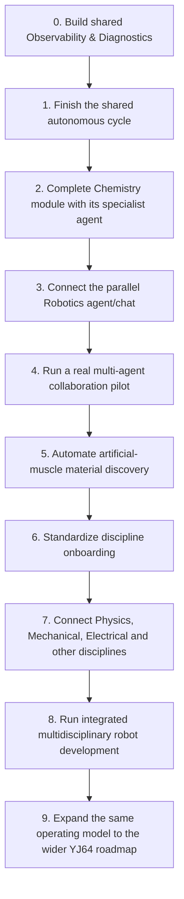

# YJ64 — Strategic Master Plan
Last reconciled: 2026-11-17
Repository: `concreteballs/YJ64-Engineering-Core`
Authorized branch: `main`

> This is the strategic graph for the whole programme. The numbered stages express the intended order. Each expandable section is the implementation checklist for that stage. Detailed engineering status remains in [IMPLEMENTATION_STATUS.md](IMPLEMENTATION_STATUS.md); autonomous-cycle technical tasks remain in [AUTONOMOUS_ENGINEERING_CYCLE_AND_MASTER_ROADMAP.md](AUTONOMOUS_ENGINEERING_CYCLE_AND_MASTER_ROADMAP.md).

## Strategic graph

Stage 0 is a cross-cutting foundation and runs in parallel with the autonomous cycle; every later stage inherits its instrumentation requirements. The graph is a dependency order, not a claim that every stage is already implemented. Work may overlap where prerequisites are satisfied, but later stages must not be called operational before their acceptance checks pass.

---

## 0. Build shared Observability & Diagnostics
**Goal:** every task, build, agent handoff and solver execution must leave enough correlated evidence to identify what failed and where, instead of debugging blindly.

Open implementation steps and acceptance criteria

### Implementation
1. Define and test the versioned event/error schema and mandatory secret-redaction rules. A tested first implementation now exists in `src/yj64_engineering_core/observability/events.py`; collection and integration remain outstanding.
2. Propagate trace, span, correlation, task, workflow, job, commit and deployment identifiers across every service boundary.
3. Standardize structured logs and safe error classification; preserve validated SQLSTATE, HTTP status, exit code and sanitized stack/log references.
4. Generate a bounded diagnostic bundle for failed/suspicious tasks: exact versions, failed step, logs, retry history, queue state, artifact hashes and environment fingerprint.
5. Add metrics for success/failure, latency, queue age/depth, retries, leases, worker health, solver duration, resource use and cost.
6. Add end-to-end distributed traces across CI → webhook → database/queue → dispatcher → worker → agent/module → solver → artifact → validation.
7. Add authenticated ingestion, durable telemetry storage, bounded offline spool/forwarding and explicit delivery acknowledgements. Reuse the existing [YJ64 monitor prototype](https://github.com/concreteballs/yj64-clean-bial2modFun5) as a source for protocol and delivery patterns, not as an Android dependency of the core.
8. Add dependency-aware readiness checks, alerts and an operator drill-down view.
9. Add evidence-based diagnostic triage that ranks hypotheses, asks for the cheapest missing evidence and proposes minimal fixes with regression tests.
10. Add fault-injection tests for database/schema/auth failures, duplicate events, expired leases, worker crashes, solver timeouts, invalid artifacts and telemetry outages.
11. Enforce telemetry retention, access controls, sampling, cardinality limits, redaction and storage/token/cost budgets.

### Mandatory module integration gate
No new or existing engineering module is considered **fully integrated** until it:
- emits events conforming to the current common diagnostic schema;
- propagates stable module/component and task/correlation identity;
- records start, completion, failure and degraded states;
- attaches relevant input/output artifact hashes and version/provenance data;
- redacts secrets and sensitive data before persistence/export;
- delivers events to shared collection, or maintains a bounded recoverable spool with visible delivery state;
- passes schema, redaction, duplicate-delivery and telemetry-outage tests.

Local-only logs or a module-specific private monitor count as prototype diagnostics, not full platform integration. A module that has not passed this gate must be labelled partially connected.

### Acceptance
- One task/run ID reveals the complete execution path and exact failed stage.
- Failures have stable categories and useful diagnostic evidence, or an explicit evidence-gap report.
- Logs, metrics and traces correlate across components.
- Automated tests prove secrets are redacted.
- Stuck work and repeated failures trigger actionable alerts.
- A fault-injection exercise localizes a failure and validates the smallest justified fix without blind retries.
- Every module passes the mandatory integration gate above.

**Existing foundation:** the webhook API already has limited safe SQLSTATE classification; the shared event envelope and initial redaction tests are now implemented. The Android monitor prototype supplies a reusable offline-spool and durable-acknowledgement pattern but is not yet integrated. See [OBSERVABILITY_AND_DIAGNOSTICS_ARCHITECTURE.md](OBSERVABILITY_AND_DIAGNOSTICS_ARCHITECTURE.md) and [YJ64_MONITOR_REUSE_AND_INTEGRATION_PLAN.md](YJ64_MONITOR_REUSE_AND_INTEGRATION_PLAN.md).

---

## 1. Finish the shared Autonomous Engineering Cycle
**Goal:** one cloud-based operating cycle that can continue work when the user's phone is offline.

Open implementation steps and acceptance criteria

### Implementation
1. Finish reliable GitHub Actions completion-event delivery to the authenticated receiver.
2. Verify actual PostgreSQL persistence in Supabase: event record, durable task, deduplication and queue state.
3. Verify atomic task claims, leases, bounded retries, completion/blocked states and recovery after worker restart.
4. Deploy a separate cloud worker that can claim tasks without relying on the phone or an open ChatGPT conversation.
5. Connect a server-side model provider using a separately configured API key; do not assume a ChatGPT subscription is an API credential.
6. Make the worker read this strategic plan, the detailed roadmap and implementation ledger; select only the next unblocked task.
7. Require exact-commit CI validation before a task is marked complete or the next dependent task is started.
8. Add bounded repair attempts, task/time/token/cost budgets, pause/resume/cancel, kill switch and safe blocked states.
9. Add external notifications and a status view for active task, queue, last commit, CI result, next task, budget and stop reason.

### Acceptance
- A task is durably queued.
- The cloud worker claims it while the phone is offline.
- It makes a small authorized change in this repository and on `main`.
- CI runs for the exact resulting commit.
- Completion event is authenticated, persisted and deduplicated.
- The worker records the evidence and advances, or stops with a clear reason.
- Restart does not lose or duplicate work.
- Pause/kill switch and budget limits are demonstrated.

**Exit gate:** do not call the cycle autonomous until the full acceptance sequence passes. Do not start broad automated module development before this gate.

## 2. Complete Chemistry & Molecular Design with its specialist agent
**Goal:** make the chemistry discipline a usable, tested engineering module before using it for sustained autonomous discovery.

Open implementation steps and acceptance criteria

### Implementation
1. Review the current Chemistry & Molecular Design contracts, tests and documented limitations with the chemistry specialist agent.
2. Identify the missing capabilities needed for responsive materials: molecular/structure intake, composition and formulation representation, processing conditions, material-property evidence and candidate comparison.
3. Keep chemistry and Artificial Muscle Engineering connected through versioned shared material request/candidate contracts.
4. Define machine-readable task inputs and outputs so the shared dispatcher can schedule chemistry work and store results.
5. Separate hypotheses, heuristic screening, deterministic calculations, external solver outputs and experimental evidence.
6. Add reproducible fixtures, benchmarks and tests for candidate generation/screening and exchange with the actuator module.
7. Record exact dependencies, versions, licences, runtime requirements and compute budgets for every proposed scientific tool.
8. Do not claim quantum chemistry, molecular dynamics, synthesis prediction or material performance prediction until the corresponding toolchain is actually integrated and validated.

### Acceptance
- The chemistry agent can receive a typed task and return a versioned, traceable result.
- The result can be consumed by Artificial Muscle Engineering without manual reformatting.
- Tests cover contracts, invalid inputs, provenance and evidence level.
- Missing solvers/data are reported as explicit limitations, not silently replaced by LLM guesses.

## 3. Connect the parallel Robotics agent/chat
**Goal:** let the agent responsible for the humanoid robot work with the same project state and shared engineering services.

Open implementation steps and acceptance criteria

### Implementation
1. Define an authenticated agent/API bridge for task submission, status retrieval and result delivery.
2. Connect the robotics agent to the common project memory: requirements, component revisions, material requests, calculations, decisions and artifacts.
3. Give the agent scoped permissions for its discipline and the authorized repository; do not grant unrelated repository access.
4. Define context handoff: task ID, objective, constraints, input versions, expected output schema and evidence requirements.
5. Make results return as structured artifacts/events, not only free-form chat messages.
6. Preserve human approval for consequential changes and operations.

### Acceptance
- The robotics agent can submit a task and retrieve its status.
- It can consume a chemistry result and return a typed engineering response.
- Task identity, provenance and version dependencies survive the handoff.
- A disconnected chat does not cause task state to disappear.

**Important:** connecting a chat is a separate integration. The shared worker cannot automatically wake or resume an arbitrary ChatGPT conversation unless a supported bridge explicitly provides that capability.

